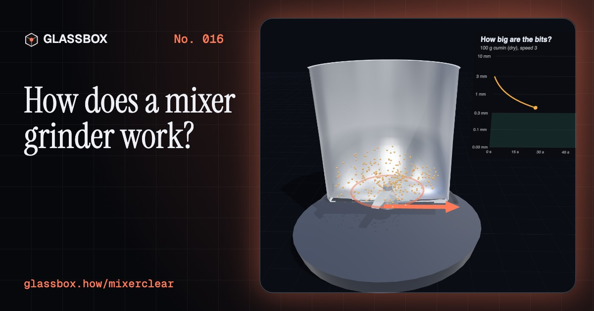
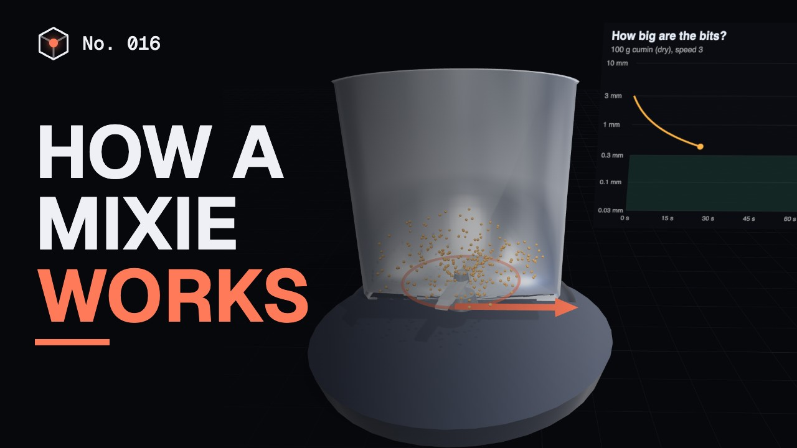
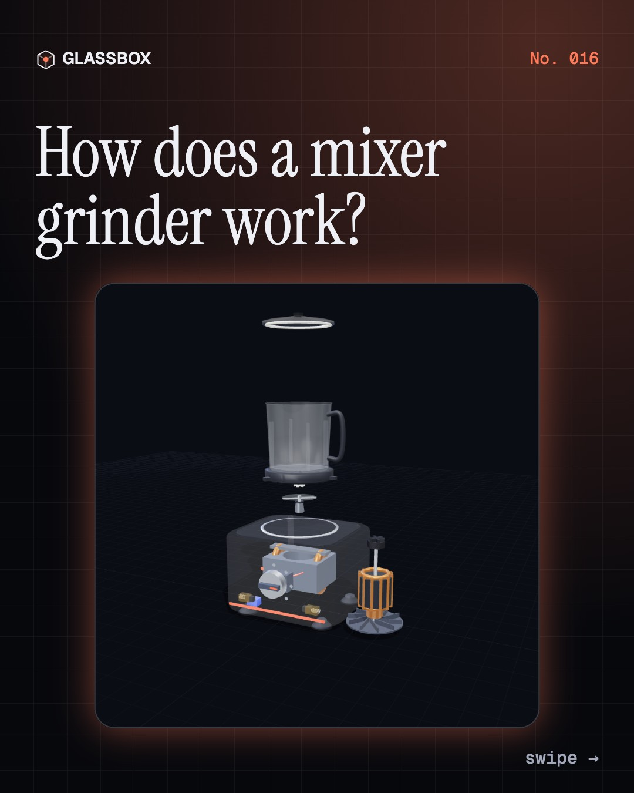
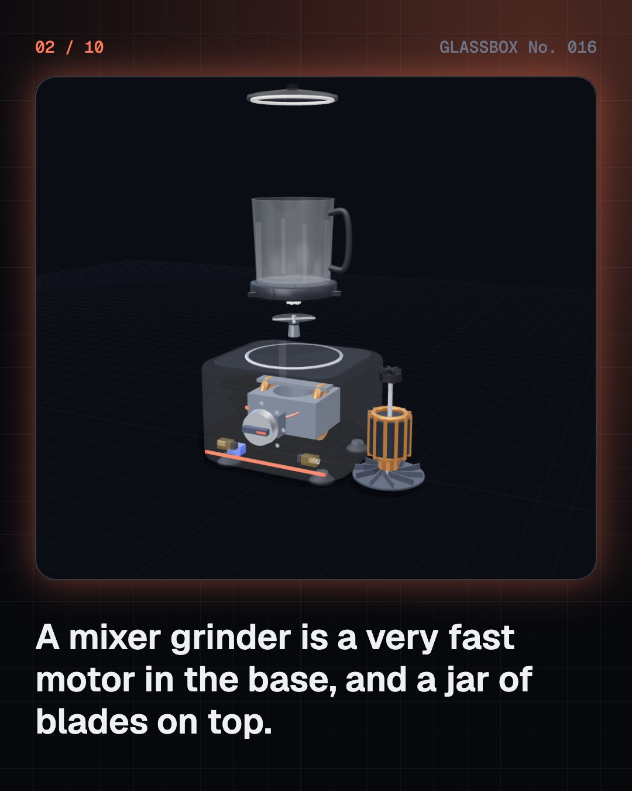
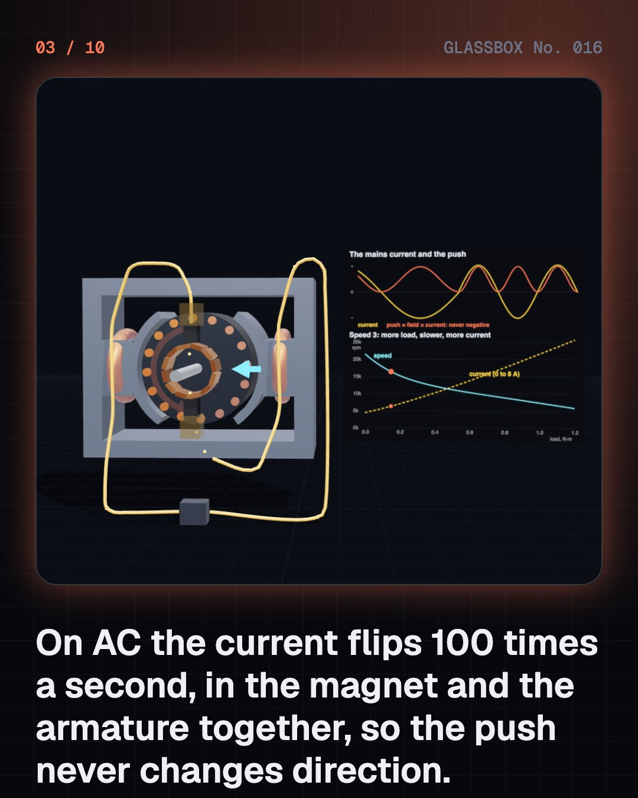
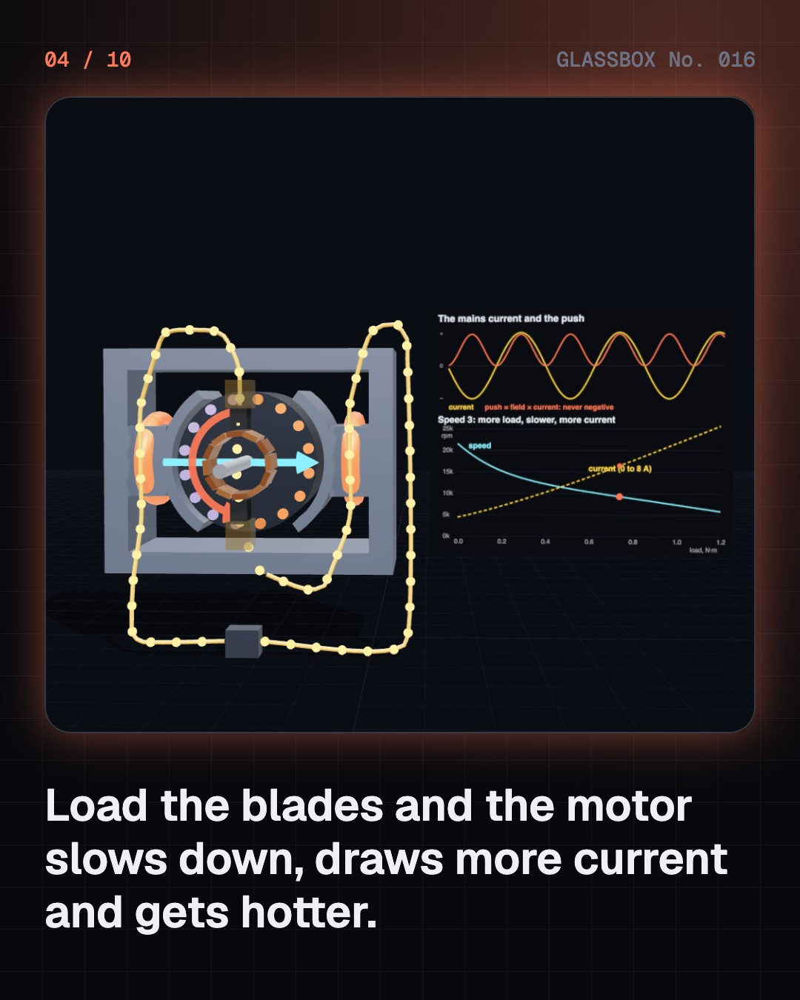

<!-- glassbox:start -->
<!-- Generated from glassbox.json by the Glassbox hub (npm run readme -- mixerclear). Edit glassbox.json, not this block. -->
<p align="center"><a href="https://glassbox-production-fd52.up.railway.app/e/mixerclear/"></a></p>

<h1 align="center">MixerClear</h1>

<p align="center"><b>How does a mixer grinder work?</b><br>A motor that spins 20,000 times a minute, blades whose tips hit 200 km/h, and ribs that stop your chutney riding round the jar. Take India's favourite kitchen machine apart in 3D.</p>

<p align="center"><a href="https://glassbox-production-fd52.up.railway.app/mixerclear/"><b>▶ Play with it</b></a> &nbsp;·&nbsp; <a href="https://glassbox-production-fd52.up.railway.app/e/mixerclear/">Read the 60-second explainer</a> &nbsp;·&nbsp; <a href="https://glassbox-production-fd52.up.railway.app/mixerclear/glassbox/reel.mp4">Watch the 40-second video</a></p>

<p align="center">
  <a href="https://glassbox-production-fd52.up.railway.app/e/mixerclear/"></a>
  <a href="https://glassbox-production-fd52.up.railway.app/e/mixerclear/"></a>
  <a href="LICENSE"></a>
  <a href="LICENSE-CONTENT.md"></a>
  <a href="#privacy"></a>
</p>

## In 60 seconds

1. **A fast motor under a jar of blades.** A mixer grinder is a heavy base holding an upright electric motor, with a jar on top. The jar's blades sit on a short shaft through a sealed bushing, and a rubber coupler links them to the motor when you set the jar down. A speed switch, a cooling fan, suction feet and an overload switch complete it.
2. **A motor that runs on AC because both halves flip.** The universal motor sends the same current through its field coils and, via carbon brushes and a commutator, through its spinning armature. When the mains flips 100 times a second, both magnets flip together, so the push never changes direction. It races at about 20,000 rpm empty and slows under load while drawing more current.
3. **Tiny blades, racing-car tip speed.** The tip speed of a blade is v = ω × r. At 18,000 rpm a tip 3 cm from the centre moves at about 57 m/s, roughly 200 km/h. The blades smash and shear the food, and bits get smaller fast at first, then more slowly, since each step finer needs more energy.
4. **Ribs stop the whole load spinning.** On its own, the load swirls round with the blade, forming a vortex, and the blade slips through food that is already moving. Ribs on the jar wall break the swirl into an up-and-down loop, so food keeps falling back into the blades. A little water, or pulse mode, helps thick loads flow back.
5. **Every watt ends up as heat.** Current heats the windings, and the work done on the food heats the food: Q = P × t. A heavy load draws more current, and heating grows with current squared, so mixers are rated for short runs. A bimetal overload switch opens if the windings get too hot, and you reset it under the base.
6. **A gram of imbalance shakes it hard.** A lump spinning with the blade pulls on the machine with F = m r ω². One gram at the blade tip at 17,000 rpm pulls with about 110 N, more than three times the mixer's weight, so it walks. Suction feet, a secure lid and the max line keep it safe.

## Words worth knowing

| Term | Meaning |
|---|---|
| **Universal motor** | A series-wound motor with brushes and a commutator that runs on AC or DC. It is small, light and very fast. |
| **Commutator** | A ring of copper bars on the motor shaft. The carbon brushes touch different bars as it turns, switching the armature coils. |
| **Back-voltage** | The voltage a spinning armature makes against the mains. The faster it spins, the less current can flow. |
| **Tip speed** | How fast the end of a blade moves: v = ω × r, turning speed times radius. |
| **Vortex** | A swirling mass of liquid whose surface dips in the middle and rises at the edge. |
| **Flow breakers** | Ribs on the inside of a jar that stop the load swirling round with the blade. |
| **Overload protector** | A heat-sensitive bimetal switch that cuts the motor's power when its windings get too hot. |
| **Duty cycle** | How long a machine may run before it must rest, such as 30 seconds on and one minute off. |
| **Unbalance** | Mass that is not spread evenly round a spinning part, so it pulls the machine round in a circle. |

## A short history

**11,000 years from a stone rubbed on a stone to the three-jar mixie whirring in nearly every Indian kitchen.**

- **2500 BCE** · The sil-batta (People of the Indus Valley civilisation, Indus Valley (today India and Pakistan))
- **500 BCE** · The stone starts to spin (Iron Age people of the Iberian Peninsula, North-east Iberian Peninsula (today Spain))
- **1905** · A tiny motor that spins very fast (Chester Beach, Racine, Wisconsin, USA)
- **1922** · Blades at the bottom of the jar (Stephen J. Poplawski, Racine, Wisconsin, USA)
- **1937** · The Waring Blendor (Fred Osius and Fred Waring, Chicago and New York, USA)
- **1955** · The electric wet grinder (P. Sabapathy, Coimbatore, Tamil Nadu)
- **1963** · Sumeet: a mixie made for Indian food (Satya Prakash Mathur and Madhuri Mathur, Mumbai, Maharashtra)
- **2006** · The limit rises to 750 watts (Bureau of Indian Standards, New Delhi)

The full story, with 29 moments, charts, people and 30 sources: [glassbox.how/e/mixerclear/history](https://glassbox-production-fd52.up.railway.app/e/mixerclear/history/). The data lives in [`history.json`](history.json).

## Video and slides

Made with the Glassbox studio from this box's storyboard (`window.glassbox.director`). Free to reuse under CC BY 4.0.

<a href="https://glassbox-production-fd52.up.railway.app/mixerclear/glassbox/video.mp4"></a>

<p><a href="glassbox/slide-1.jpg"></a> <a href="glassbox/slide-2.jpg"></a> <a href="glassbox/slide-3.jpg"></a> <a href="glassbox/slide-4.jpg"></a></p>

| File | What | Size |
|---|---|---|
| [`glassbox/reel.mp4`](https://glassbox-production-fd52.up.railway.app/mixerclear/glassbox/reel.mp4) | Reel / Short, with captions and soundtrack | 1080×1920 |
| [`glassbox/video.mp4`](https://glassbox-production-fd52.up.railway.app/mixerclear/glassbox/video.mp4) | YouTube video, with captions and soundtrack | 1920×1080 |
| `glassbox/slide-1…10.jpg` | Instagram carousel | 1080×1350 |
| `glassbox/thumb.jpg` | YouTube thumbnail | 1280×720 |
| `glassbox/cover.jpg` | Share card and repo social preview | 1200×630 |
| [`glassbox/history-reel.mp4`](https://glassbox-production-fd52.up.railway.app/mixerclear/glassbox/history-reel.mp4) | “History in 10 moments” Reel / Short | 1080×1920 |
| `glassbox/history-slide-*.jpg` | History carousel | 1080×1350 |
| `glassbox/post.json` | Post copy and schedule used by the publish kit | |

## Privacy

This box has no accounts and no ads, and it ships its own fonts and libraries. When you run it yourself it sends nothing anywhere. On glassbox.how, the site's `/bar.js` also loads Glassbox's analytics: **Google Analytics** to count visits (it asks first in the EU, UK and Switzerland, and stays off when your browser sends Global Privacy Control or Do Not Track) and **ClickTrust** to detect bots.

It remembers a few things **in your own browser only**, and never sends them anywhere:

| Browser storage key | What it holds |
|---|---|
| `mixerclear.v1` | Which chapters you have opened, your best quiz scores, and sound on or off. |

Exactly what each one sees is at [glassbox.how/privacy](https://glassbox-production-fd52.up.railway.app/privacy/).

## Licences

- **Code:** [MIT](LICENSE). Use it, change it, ship it.
- **Explanations, text, images and videos** (`glassbox.json`, `glassbox/`): [CC BY 4.0](LICENSE-CONTENT.md). Credit “Glassbox, glassbox.how/e/mixerclear”.
- **Third-party parts** keep their own licences: [three.js](https://threejs.org) (MIT), [Geist, Instrument Serif](https://openfontlicense.org) (SIL OFL 1.1).
- The Glassbox name and logo aren't covered by either licence. See the [terms](https://glassbox-production-fd52.up.railway.app/terms/).

Found a mistake? [Open an issue](https://github.com/bdeeps/mixerclear/issues). Corrections happen in public.
<!-- glassbox:end -->

## Run it

It's plain HTML, CSS and JavaScript. No build step and no dependencies. Run locally, it contacts no other website.

```bash
python3 -m http.server 8000
```

Three.js and the fonts ship in `vendor/` and `fonts/`, so it also works offline.

Then open http://localhost:8000.

## How it's built

| File | What |
|---|---|
| `index.html`, `css/app.css` | The page and its styles |
| `js/app.js`, `js/stage.js`, `js/ui.js`, `js/kit.js` | The shared Glassbox 3D engine: chapters, 3D stage, controls, quiz, video director |
| `js/chapters/*.js` | One file per chapter: the 3D model, controls, text, key terms, quiz and video scenes |
| `js/mixer.js` | The mixer models and physics shared by the chapters: the universal motor's speed, current and power, the three jars and blades, the base unit, grinding (Rittinger's law) and flow tracers in the jar |
| `glassbox.json` | Title, question, explainer beats, key terms, browser storage and credits shown on glassbox.how |
| `reel` in each chapter | The storyboard the Glassbox studio records into short videos |
| `glassbox/` | The published video, slides, thumbnail and post copy |
| `fonts/`, `vendor/three/` | Self-hosted Geist and Instrument Serif (SIL OFL 1.1) and three.js (MIT) |
